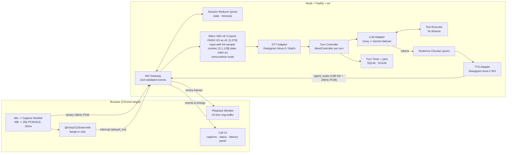

# Voice Agent MVP — Architecture & Roadmap

Real-time voice agent: browser mic → Silero VAD → streaming STT → LLM (+tools) → sentence-level TTS → speaker.

This document synthesizes [Technical Assignment.pdf](../Technical%20Assignment.pdf) with our self-paced, zero-cost-tier architecture and phased roadmap.

---

## 1. Goals & Acceptance Criteria

Must pass all 10 acceptance criteria from §7 of the spec:

1. User completes a 5+ turn conversation and the agent remembers earlier turns.
2. Median time from end of user speech to first agent audio ≤ 1.5 s (measured over 20 test turns).
3. Live captions show partial (`transcript_partial`) and final (`transcript_final`) transcripts.
4. Barge-in works: agent audio stops within ~300 ms of user speaking.
5. Sample tool (`get_order_status` / `get_current_time`) is invoked correctly when asked a relevant question.
6. All failure cases in §8 behave as described.
7. Each session's transcript and per-stage latencies are persisted and retrievable by `session_id` (`GET /sessions/:id`).
8. Swapping one provider (e.g., TTS or STT) needs only config + a new adapter, with zero pipeline changes.
9. Unit tests for state transitions and adapters (mocked); one integration test running a recorded audio file through the full pipeline with zero API keys.
10. `README.md` with setup, env vars, architecture diagram, and local run instructions.

### Latency & Quality Targets

| Metric | Spec | Target |
| :--- | :--- | :--- |
| Median end-of-speech → first audio (20 turns) | ≤ 1.5 s | ≤ 1.2 s |
| p90 end-of-speech → first audio | — | ≤ 1.6 s |
| Barge-in: user speaks → agent audio stops | ~300 ms | ≤ 250 ms |
| CI | — | Unit + integration tests, zero API keys |

---

## 2. Tech Stack & Zero-Cost Guardrails

| Layer | Pick | Why (with Phase 0 measured facts) |
| :--- | :--- | :--- |
| Language | TypeScript (strict), Node 22+ (tested on Node 24), pnpm workspaces | Shared protocol schemas between client, server, and bench |
| Server | Fastify + `@fastify/websocket` (`ws`), `pino` logs | Typed routes and structured logs with `session_id` / `turn_id` |
| Client | Vite + React + Tailwind, AudioWorklets | Native-rate `AudioContext` (`44.1`/`48 kHz`); `?worker&url` (`worker.format: "es"`); zero-gain sink; downmix 2ch→mono in worklet; 63-tap Kaiser FIR (`β=6.5`, cutoff `6,720 Hz`) + Catmull-Rom (`85 dB`/`78 dB` 10 kHz rejection; worst spur `58.8 dB` at 44.1k); WebRTC processing on (`0.86` env NCC, ~10–13 ms shift) / off (`0.9994` waveform NCC) |
| Server VAD | Silero VAD v6.3 (pinned SHA-256 `f6f4407b...`; ONNX I/O `[1,576]` + 64-sample context, `[2,1,128]` state, `int64` sr) via `onnxruntime-node` | `p50 0.29 ms` / `p95 0.50 ms` per 32 ms window (warm-up excluded); `+1..+46 ms` vs labels; move to worker thread around ~100 sessions |
| Client VAD | `@ricky0123/vad-web` | Local barge-in detection avoids network RTT before stopping playback |
| STT (streaming) | Deepgram Nova-3 live WebSocket (`wss://api.in.deepgram.com`) | India endpoint: TCP `40 ms`, fresh WS open `171 ms`, `stt_final` (`Finalize→from_finalize`) `80 ms` med / `119 ms` p90 (vs US `api.deepgram.com`: TCP `253 ms`, open `829 ms`, `stt_final` `275 ms`). `linear16` 16 kHz mono, `interim_results`, `smart_format` + numerals (`"one zero four two"` → `"1042"`), `endpointing=false`, `KeepAlive` between turns, pre-warmed per session; confirm burst gives `403 ms` first caption vs `777 ms` real time |
| STT (batch) | Groq `whisper-large-v3-turbo` (`api.groq.com`, `bom`) | `266 ms` request → transcript, 100% accuracy (swap/fallback adapter; cannot emit partial captions). Free quota: `7,200` audio-s/h, `28,800`/day, `20 RPM`, `2,000 RPD`, `10 s` min billed/req |
| LLM | Groq OpenAI-compatible API (HTTP/2 `undici` `Agent`) + Gemini failover | Inference in Mumbai (`x-groq-region: bom`, `-MAA` edge, ~90 ms network; `/models` ~300 ms is control-plane only; HTTP/2 avoids `+90–135 ms` H1 abort reconnect). Primary `openai/gpt-oss-120b` (`reasoning=low`, warm H2 TTFT `~447 ms`, ~318 ms queue med); fallback `openai/gpt-oss-20b`; candidate `qwen/qwen3.8-27b` (`~195 ms` TTFT) pending `tools-v3` run; failover `models/gemini-3.5-flash-lite` (`thinking=minimal`, `615–836 ms` TTFT, 1 chunk). Prompt `voice-v2`; `tools-v3` (parameterless `get_current_time`). Free limits: `200k` TPD/model, `1,000` RPD, `8k` TPM, `30` RPM, `on_demand` only |
| TTS | Deepgram Aura-2 `aura-2-thalia-en` over `wss://api.in.deepgram.com/v1/speak` | `linear16` `24 kHz` mono, 1 pre-warmed socket/call (`184.5 ms` open vs `840.1 ms` US), `tts_first_audio` `107 ms` med (`111 ms` p90) vs `353 ms` US, `Clear→Cleared` `42.5 ms` (`100%` survival), WS `ping` every ~20 s survives `300 s` idle (`{"type":"KeepAlive"}` closes `1008 DATA-0000`), Flush cap `20/60 s` → Flush sentence 1 + end-of-turn; default host stalled `13–23 s` / `30 s` timeout |
| DB | SQLite (`better-sqlite3`) + Drizzle locally | Zero-setup local persistence (use Supabase Postgres if deployed to ephemeral Render) |
| Validation | Zod for WS events and env config | Shared runtime + static validation |
| Tests / CI | Vitest, GitHub Actions | Fast unit + keyless recorded-audio integration tests |

**Zero-cost rule:** Never attach a payment card to any provider account.
- **Deepgram:** \$200 signup credit, no credit card, non-expiring.
- **Groq & Gemini:** Free tiers with rate limits (develop primarily against fake adapters and replay fixtures to stay well under daily limits).
- **Hosting (optional):** Render free tier (no card; sleeps after 15 min idle, ephemeral disk).

---

## 3. System Architecture & Core Principles



### Core Principles
1. **Functional core, imperative shell:** `session/reducer.ts` is pure: `(state, event) => { state, effects }`. `session/runtime.ts` executes side effects.
2. **Pipeline sees interfaces only:** Vendor SDKs and URLs live strictly in `apps/server/src/adapters/<kind>/<vendor>.ts`. `adapters/factory.ts` is the only module reading `*_PROVIDER` config. Enforced by ESLint `no-restricted-imports`.
3. **One `AbortController` per turn:** LLM fetch, tool calls, and TTS streaming all observe the same `AbortSignal`. Cancelling a turn is a single `abort()`.
4. **Turn-tagged outbound audio:** Every server→client `agent_audio` binary frame carries its `turn_id` and `seq`, announced by `audio_start`. Client drops frames from interrupted/stale turns immediately.
5. **Pre-warm at session start:** Open STT/TTS sockets and keep-alive connections on `session_start` (transitioning `IDLE → LISTENING` on `PREWARM_DONE` + `session_ready`) so turns avoid cold TLS handshakes.

---

## 4. Repo Layout

```text
amadeus/
├─ AGENTS.md
├─ .agents/
│  ├─ rules/                  # architecture.md, audio.md, testing.md
│  └─ skills/                 # /check, /new-adapter
├─ spikes/                    # Phase 0 standalone learning spikes
├─ apps/
│  ├─ server/src/
│  │  ├─ main.ts              # Fastify boot, REST routes, WS gateway
│  │  ├─ config.ts            # Zod-validated env
│  │  ├─ session/             # reducer.ts (pure), runtime.ts, manager.ts
│  │  ├─ pipeline/            # turn-controller.ts, chunker.ts (pure), history.ts, prompt.ts
│  │  ├─ vad/                 # silero.ts (ONNX), segmenter.ts (pure)
│  │  ├─ adapters/            # types.ts, factory.ts, stt/, llm/, tts/
│  │  ├─ tools/               # registry.ts, order-status.ts, current-time.ts
│  │  ├─ metrics/             # turn-timer.ts
│  │  ├─ db/                  # schema.ts, repo.ts
│  │  └─ assets/clips/        # pre-rendered fallback & goodbye WAVs
│  └─ web/src/
│     ├─ audio/               # capture.worklet.ts, playback.worklet.ts
│     ├─ call/                # useVoiceCall.ts
│     └─ components/          # CallControls, StatusPill, Captions, LatencyPanel
├─ packages/
│  ├─ protocol/               # Zod events + binary frame codec (client, server, bench)
│  └─ audio/                  # PCM16<->Float32, resampler, WAV read/write
├─ fixtures/audio/            # 20 recorded 16kHz WAVs + expected transcripts
├─ scripts/                   # bench.ts, ping-providers.ts, gen-clips.ts
└─ docs/                      # ARCHITECTURE.md, DESIGN_NOTE.md, latency-report.md
```

---

## 5. Contracts

`docs/DESIGN.md` is the single source of truth for M1 contracts (`packages/protocol/**` and `apps/server/src/adapters/types.ts` are human-owned):

- **Wire protocol ([`DESIGN.md` §2](DESIGN.md#2-wire-protocol-packagesprotocol-zod-versioned)):** Client sends raw `640 B` `PCM16LE` 16 kHz mono frames (`seq 0` = first frame after `session_ready`). Server sends `10 B` LE header (`u8 kind=1`, `u8 version=1`, `u32 turn_id`, `u32 seq`) + `PCM16LE` 24 kHz mono frames, bracketed by `audio_start { turn_id, kind, seq }` and `agent_audio_end { turn_id, total_bytes }`, plus Zod-validated JSON events.
- **Adapter interfaces ([`DESIGN.md` §4](DESIGN.md#4-adapter-interfaces-appsserversrcadapterstypests)):** Call-scoped `VadSession`, `SttSession`, and `TtsSession` (`startTurn(turnId, signal)`), turn-scoped `LlmAdapter.stream(..., signal)`, and `Tool<TArgs>`, plus keyless `Fake*` adapters and batch/REST swap proofs.
- **Persistence & API ([`DESIGN.md` §8](DESIGN.md#8-persistence-sqlite--drizzle--get-sessionsid)):** SQLite + Drizzle tables (`sessions`, `turns` with `kind: "reply" | "clip"`, `tool_calls`, `turn_metrics` with nullable `t0_seq`, `errors`) flushed per turn so `GET /sessions/:id` works live and post-call.

---

## 6. Turn Lifecycle & Barge-In

See [`DESIGN.md` §3](DESIGN.md#3-session-reducer-appsserversrcsessionreducerts), [`§7`](DESIGN.md#7-barge-in-history--spoken-form-normalization), and [`§9`](DESIGN.md#9-provider-connection-lifecycle-decided) for the full state table, guard classes, and provider lifecycle:

- **Reducer & scopes:** Pure `(state, event) => { state, effects }` over `IDLE → LISTENING ↔ THINKING ↔ SPEAKING → ENDED` (`PREWARM_DONE` emits `session_ready`), with monotonic `captureTurnId` (open speech) and `activeTurnId` (thinking/playing), generation-guarded timers, and `goodbyeTurnId` drain guard.
- **VAD, STT & chunker:** Silero v6.3 (`0.5/0.35`, `256 ms` confirm, `576 ms` VAD end, `500 ms` pre-roll burst from `start − 100 ms`), Deepgram Nova-3 (`Finalize` on `VAD_END`, `KeepAlive` every `~5 s` between turns only on STT), and pure sentence chunker + deterministic spoken-form ID rewriting (`"1042"` → `"1 0 4 2"`).
- **Barge-in & echo:** Client `@ricky0123/vad-web` stops playback and sends `interrupt { turn_id, played_ms, detect_to_stop_ms }` for proportional heard-text truncation; server runs provisional echo carry-over (`echoSuspect` + `VOICED_AFTER_REF` at `250 ms`) and `Clear` + WS `ping` (`~20 s`, never `KeepAlive`) on Deepgram TTS `/v1/speak`.

---

## 7. Latency Budget (`performance.now()`)

Measured Phase 0 medians (server local in India): `576 + 80 + 447 + ≤ 48 + 107 ≈ 1,258 ms` (`openai/gpt-oss-120b`) and `≈ 1,033 ms` (`qwen/qwen3.8-27b`, pending `tools-v3`); tool turns `≈ 1.6 s` (`gpt-oss`) / `≈ 1.35 s` (`qwen`).

| Stage | Measurement | Phase 0 Measured (India) | Spec / Target Budget |
| :--- | :--- | :--- | :--- |
| `vad_end_ms` | Last voiced frame arrival → VAD end decision | `576 ms` (18 × 32 ms windows) | `576 ms` (550 ms hang quantized) |
| `stt_final_ms` | `Finalize` → `from_finalize` (`api.in.deepgram.com`) | `80 ms` med / `119 ms` p90 | `≤ 200 ms` |
| `llm_first_token_ms` | Final transcript → first content token (H2) | `447 ms` med (`gpt-oss-120b`, ~320 ms queue); `195 ms` (`qwen`); `615–836 ms` (Gemini) | `≤ 450 ms` (spec total ≤ 1.5 s) |
| `first_sentence_ms` | First content token → first chunk sent to TTS | `18–48 ms` (`gpt-oss`), `~75 ms` (`qwen`) | `≤ 80 ms` |
| `tts_first_audio_ms` | `Flush` → first `agent_audio` (`api.in.deepgram.com` warm WS) | `107 ms` med / `111 ms` p90 | `≤ 250 ms` |
| `total_ms` | Last voiced frame → first `agent_audio` sent | `≈ 1,258 ms` med (`gpt-oss-120b`); `≈ 1,033 ms` (`qwen` est.) | `≤ 1,500 ms` (spec) |

---

## 8. Error Handling Matrix

See [`DESIGN.md` §6](DESIGN.md#6-error-matrix--timeouts) for the full 18-row failure matrix and `~10×` p90 timeouts:

- **Timeouts:** `stt_final` `1000 ms`, `llm_first_token` `2000 ms`, `llm_budget` `3500 ms`, `tool` `3000 ms`, `tts_first_audio` `1500 ms`, `tts_stall` `2000 ms`, `goodbye_close` `clip_ms + 1000 ms`, `silence` `120 s`, `max_call` `600 s`.
- **Failover & retries:** Pre-warm retries once (`PREWARM_FAILED` → `internal_error` with zero audio); `tool_use_failed` retries once on the same model; pre-first-token LLM errors/429s fail over `gpt-oss-120b → gpt-oss-20b → gemini-3.5-flash-lite` within `3500 ms` `llm_budget`.
- **Clips & protocol:** Recoverable active-turn failures flush metrics once (`outcome = "fallback" | "failed"`) and play a pre-rendered fallback clip (`kind = "clip"`); `silence`/`max_call` play the goodbye clip under `goodbyeTurnId`; bad sequence (`MIC_FRAME` before `session_ready`), `len !== 640`, or version mismatch close WS immediately.

---

## 9. Testing Strategy

- **Unit (`pnpm test`):** Pure reducer table tests, chunker, pure segmenter (synthetic probability arrays), `played_ms` truncation, tool timeouts/errors, Zod protocol round trips, adapters vs local mock WS/fetch. Zero API keys.
- **Integration (`pnpm test:int`):** Stream fixture WAVs through real Silero VAD + fake adapters (`FakeStt`, scripted `FakeLlm` with tool calls, `FakeTts` timed silence), asserting event order, state transitions, DB rows, and barge-in. Zero API keys.
- **Bench (`pnpm bench`):** Real keys, 20 fixture WAVs (`ffmpeg -i in.m4a -ac 1 -ar 16000 -sample_fmt s16 out.wav`), writes `docs/latency-report.md` with median and p90 per stage + end-to-end.

---

## 10. Phased Roadmap (Self-Paced)

- **Phase 0 — Spikes (`spikes/`):** Standalone scripts validating each API/runtime before Phase 1:
  1. `spikes/silero-vad` ✔: Silero VAD v6.3 ONNX in Node (`onnxruntime-node`, `512 + 64` context + `state`, pure segmenter).
  2. `spikes/browser-capture` ✔: Browser mic capture worklet (`48/44.1 kHz → 16 kHz` Kaiser FIR + Catmull-Rom) + fake-mic E2E capture-to-VAD smoke.
  3. `spikes/deepgram-stt` ✔: Deepgram Nova-3 live WS (`api.in.deepgram.com`) vs Groq Whisper batch benchmark.
  4. `spikes/groq-llm` ✔ (`qwen/qwen3.8-27b` `tools-v3` run pending): Groq HTTP/2 streaming, `voice-v2` + `tools-v3`, `gpt-oss-120b`/`20b`, Gemini failover.
  5. `spikes/deepgram-tts` ✔: Deepgram Aura-2 `/v1/speak` WS (`api.in.deepgram.com`) vs REST, `Clear` survival, idle probe, spoken-form IDs.
- **Phase 1 — Spec MVP (M1–M4):**
  - M1: pnpm monorepo, TS strict, ESLint import boundary, Vitest, CI, `packages/protocol`, `config.ts`, `POST /sessions` + WS echo, `ping-providers.ts`.
  - M2: Capture/playback worklets, `packages/audio`, Silero + pure segmenter, pure reducer + manager, batch path (Whisper + Groq + Deepgram REST), turn timer, SQLite, `GET /sessions/:id`.
  - M3: Deepgram live STT + captions, LLM streaming + pure chunker + Aura-2 WS TTS, turn-tagged frames, multi-turn history.
  - M4: Barge-in + `played_ms`, streamed tool-call loop, error matrix + pre-rendered clips, Gemini failover, keyless CI integration test.
- **Phase 2 — Resume-Ready:** Live latency waterfall panel, 20-turn bench report (`docs/latency-report.md`), `README.md`, `DESIGN_NOTE.md`, 2:30 demo video (plus optional Render + Supabase deploy).
- **Phase 3 — Depth (pick 1–2):** Deepgram Flux vs Silero+Nova-3 comparison; concurrency load test; fully local mode (`whisper.cpp` + Ollama + Piper); adaptive endpointing.
